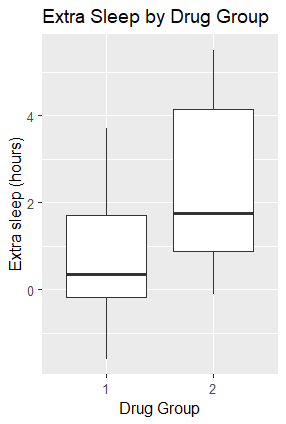
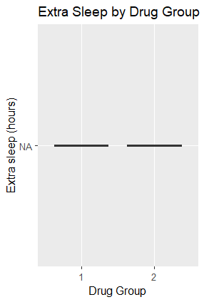

:::::::::::::::::::::::::::::::::::::: questions 

- What is a project environment and why does it matter?
- How can we create a project environment?

::::::::::::::::::::::::::::::::::::::::::::::::

::::::::::::::::::::::::::::::::::::: objectives

- Explain the purpose of an project environment.
- Create a project environment using `renv`.
- Use use `renv::snapshot()` to take implicit and explicit snapshots of the environment.
- Restore an environment using a lockfile or using a `DESCRIPTION` file.

::::::::::::::::::::::::::::::::::::::::::::::::

## Running someone else's script

A colleague emails you an R script called [sleep_analysis.R](files/02-environments/sleep_analysis.R) and asks you to reproduce their results while they are away.

Before running anything, create an R project to organise your work.

### Create an R project

Create a folder called `rworkshop` in your home directory to hold your workshop files.
Then create an R project inside it using RStudio:

- Go to **File > New Project > New Directory > New Project**
- Name the directory `sleep`
- Create it as a subdirectory of `rworkshop` (for example: `C:/Users/username/rworkshop/`)
- Leave the other settings at their defaults, with options such as **Create a git repository** and **Use renv with this project** unticked
- Click **Create Project**
 
To return to your work later, open `sleep.Rproj` in the `sleep` folder.
Double‑clicking this file launches RStudio, sets the working directory, and restores your project as you left it.

### Save the script

Download [sleep_analysis.R](files/02-environments/sleep_analysis.R) and save it in the `sleep` folder.
Open it in RStudio to view the code your colleague sent you:

``` R
library(obscurepackage)
library(ggplot2)

data <- sleep
none_transformed_data <- none_transform(data$extra)

p <- ggplot(data, aes(x = group, y = none_transformed_data)) +
  geom_boxplot() +
  labs(
    title = "Extra Sleep by Drug Group",
    x = "Drug Group",
    y = "Extra sleep (hours)"
  )

print(p)
```

### Run the script

Run `sleep_analysis.R` to see what happens.

In RStudio, you can run the script using your editor’s **Source** button.

You will probably hit an error resulting in a message that looks like the one below.

``` R
Error in library(obscurepackage) : 
  there is no package called ‘obscurepackage’
```

The script tries to load:
``` R
library(obscurepackage)
```

On your machine, R looks for packages in its configured R libraries.
You might already have `ggplot2` installed, but you probably do not have `obscurepackage` installed, so the script fails.

### Install the required packages

You may already have `ggplot2` installed, but if not, you can install it with:

``` R
install.packages("ggplot2")
```

R downloads and installs `ggplot2` and any required dependencies.
You should see installation progress in the console, followed by the return of the `>` prompt.
Check for errors before continuing.

The `obscurepackage` is not on CRAN.

First, install the remotes package, which allows you to install packages from GitHub:

``` R
install.packages("remotes")
```

R downloads and installs `remotes`.
Wait for installation to finish and check for errors before continuing.

Then, install `obscurepackage`:
``` R
remotes::install_github("stellaprins/obscurepackage")
```

::::::::::::::::::::::::::::::::::::: challenge
## Reproduce the results

Now that you have installed the required packages, are you able to reproduce the plot below?

If not, what happens, and why do you think the results differ?

**Hint:** visit the [`obscurepackage` GitHub repository](https://github.com/stellaprins/obscurepackage) and explore its commit history.
Have any changes been made that could explain the difference?


{alt="Boxplots of extra sleep for drug groups 1 and 2." width='50%'}

:::::::::::::::::::::::: solution

## Show me the solution

You will not be able to reproduce your colleague's original plot using the latest version of `obscurepackage`.

Instead, you should see something like this:

{alt="Plot of extra sleep for drug groups 1 and 2, showing NA for both groups instead of boxplots." width='50%'}

The difference is caused by a bug introduced in a newer version of `obscurepackage`.

The `none_transform()` function was originally designed to return its input unchanged:

```r
none_transform <- function(x) {
  return(x)
}
```

However, a bug introduced in the newer version causes the function to always return `NA`, regardless of its input:

```r
none_transform <- function(x) {
  return(NA)
}
```

As a result, the analysis produces missing values instead of the expected data, preventing the original boxplot from being reproduced.

To reproduce your colleague's results, you would need to install an earlier version of `obscurepackage` that does not contain the bug.

Changes to software dependencies can affect reproducibility, even when the code and data remain unchanged. 
This highlights the importance of recording and managing package versions.

:::::::::::::::::::::::::::::::::

::::::::::::::::::::::::::::::::::::::::::::::::

## Project environments

Different versions of an R package can behave differently.

This can be due to new features, altered defaults, or bugs, and causes the same code to produce different results.

A version mismatch happens when your script relies on a package whose behaviour has changed between releases.

A project environment helps prevent this by isolating the packages your project uses and recording their versions.

This keeps your work separate from whatever happens to be installed globally on your system and avoids conflicts between R projects that require different or incompatible dependencies.

Recording package versions in a project environment also helps you rebuild the setup, for example when someone else needs to run your analysis or you return to the project in the future.

::::::::::::::::::::::::::::::::::::: callout

## Two different meanings of environment in R

**1) project environments**  
These are project‑specific libraries created by the `renv` package.
They store packages and their versions, helping you reproduce your project on other machines.

**2) R environments**  
These store variables and track where functions were created, and control how R finds values.
They enable features like lexical scoping and namespaces.

::::::::::::::::::::::::::::::::::::::::::::::::

In this workshop, we are going to use an R package called `renv` to manage our project environment.

To install `renv`:
``` R
install.packages("renv")
```

R downloads and installs `renv`.
Wait for installation to finish and check for errors before continuing.

::::::::::::::::::::::::::::::::::::: challenge

## Find out more about `renv`

Open the `renv` help page in the R console:
``` R
?renv
```

Explore the help page and useful links.

In your own words, explain:

- What does `renv` do?
- How can `renv` help when handing the project over to a colleague?

:::::::::::::::::::::::: solution

## Show me the solution

`renv` is an R package that helps create reproducible environments.

`renv` gives every R project its own library of packages, separate from everything else on your computer, and records the package versions the project uses.

When you hand a project to someone else, `renv` can restore the package versions recorded in `renv.lock`.

This helps them recreate your project environment and run the analysis using the same package versions.

Differences in R versions, operating systems, or system libraries can still affect the results.

:::::::::::::::::::::::::::::::::

::::::::::::::::::::::::::::::::::::::::::::::::

Initialise `renv`:

``` R
renv::init()
```

This will:

  - Set up project infrastructure inside your working directory that ensures `renv` will be used in future sessions
  - Discover packages used in your project and add them and their dependencies to the project library
  - Create a "lockfile" named `renv.lock` that records the versions of your project's package dependencies
  - Restart R if you are using RStudio.

### Install packages in the project environment

Before using `renv`, we installed packages using `install.packages()`.
Packages are installed into an R library, which may be shared by several projects.
When `renv` is active, `install.packages()` normally uses the project library.

This installs `ggplot2` only into the project’s `renv` library, leaving the global library untouched:

``` R
renv::install("ggplot2")
```

::::::::::::::::::::::::::::::::::::: challenge
## Install a GitHub package 

Use the help page for `renv::install` to learn how to install packages inside the `renv` environment.
``` R
?renv::install
```

- Use the help page to find out how to install a package from GitHub using `renv::install()`
- Use what you learned to install `v0.1.0` of the GitHub repository [`stellaprins/obscurepackage`](https://github.com/stellaprins/obscurepackage).

**Hint:** Explore the repository's commit history to find the commit corresponding to `v0.1.0`, and check how to specify a commit hash when using `renv::install()`.

:::::::::::::::::::::::: solution

## Show me the solution

From the help page, GitHub packages can be installed by using the `username/repository` string, and specific versions can be installed by supplying a commit SHA.

The commit SHA for `v0.1.0` of `stellaprins/obscurepackage` is [`9e7cfcba9bfbfd1cbea4dbc1600f8d5283c71831`](https://github.com/stellaprins/obscurepackage/commit/9e7cfcba9bfbfd1cbea4dbc1600f8d5283c71831).


``` R
renv::install("stellaprins/obscurepackage@9e7cfcba9bfbfd1cbea4dbc1600f8d5283c71831")
```

:::::::::::::::::::::::::::::::::

::::::::::::::::::::::::::::::::::::::::::::::::

To install a specific version of a GitHub package inside a `renv` project, use the `username/repo@version` format:

``` R
renv::install("stellaprins/obscurepackage@v0.1.0")
```

Restart your R session to make sure R uses the newly installed version of `obscurepackage`.

In RStudio, select **Session > Restart R**, or run:

``` R
.rs.restartR()
```

**Note:** `.rs.restartR()` only works in RStudio, not in a standard R terminal or other R editors.

Then run `sleep_analysis.R` again.

You should be able to replicate the results of your colleague!

{alt="Boxplots of extra sleep for drug groups 1 and 2, with a higher median for group 2." width='50%'}

## Recording your environment with a lockfile

You have now reproduced your colleague's results by installing a specific version of `obscurepackage`.

But how can you make sure that you, or someone else, can reproduce these results again in the future?

This is where a **lockfile** comes in.

When you initialise `renv`, it creates a file called `renv.lock`. 

This file records information about your project's software dependencies, including:

- The R version used by the project
- The packages required by the project
- The exact versions of those packages
- Where the packages were installed from, such as CRAN or GitHub

Now that you have installed a different version of `obscurepackage`, your project environment has changed. 

These changes are not automatically recorded in your `renv.lock` file.

To check whether your project environment is consistent with your lockfile, use:
``` R
renv::status()
```

`renv::status()` compares three things:

- `renv` project library
- the `renv.lock` file
- What your project actually uses

If these differ, `renv::status()` will report inconsistencies such as:

- packages installed but not recorded
- packages recorded but not installed
- packages where the installed version ≠ recorded version

Once you have reviewed these differences, you can use `renv::snapshot()` to update the lockfile and record the current state of your project environment.

::::::::::::::::::::::::::::::::::::: challenge

##  Update your lockfile using a snapshot
Run:

``` R
renv::status()
```

Look at the output. 

Now take a snapshot using `renv::snapshot()`:
``` R
renv::snapshot()
```

Then, run `renv::status()` again:

``` R
renv::status()
```

Compare the `renv::status` outputs before and after taking a snapshot:

- Which inconsistencies disappeared?
- Which (if any) remain?
- Why did snapshotting fix these issues?

:::::::::::::::::::::::: solution

## Show me the solution

After taking the snapshot, `renv::status()` may report:
``` R
No issues found -- the project is in a consistent state.
```

`renv::snapshot()` updates the lockfile to record the installed versions of your project's dependencies and the R version.

This can resolve inconsistencies between the lockfile and the project library.
However, it does not install missing packages. 
Some issues may still require `renv::install()` or `renv::restore()`.

:::::::::::::::::::::::::::::::::

::::::::::::::::::::::::::::::::::::::::::::::::

Use `renv::snapshot()` to record your project's current package dependencies and their versions in the lockfile.

``` R
renv::snapshot()
```

## Restoring an environment from a lockfile

While `renv::snapshot()` records your current environment, `renv::restore()` recreates the environment described by the lockfile.


| Command | Purpose |
|---|---|
| `renv::status()` | Check whether the project environment and lockfile are consistent |
| `renv::snapshot()` | Record the current environment in the lockfile |
| `renv::restore()` | Recreate the environment described by the lockfile |

Use `renv::restore()` when:

- You open a project on a new computer
- You clone someone else's project from GitHub
- You want to return to a known working state


## `DESCRIPTION` files

You receive an email from your colleague.
Apparently the earlier file (`sleep_analysis.R`) was the wrong one.

This time, your colleague sent you two files: [sleep_analysis_final.R](files/02-environments/sleep_analysis_final.R) and [DESCRIPTION](files/02-environments/DESCRIPTION).

In their message, your colleague explains that you should use the `DESCRIPTION` file to create the correct R environment for running the analysis.

Continue in the same `sleep` project.
Download the [DESCRIPTION file](files/02-environments/DESCRIPTION) and save it in `rworkshop/sleep`.

Download [sleep_analysis_final.R](files/02-environments/sleep_analysis_final.R) and save it in the same folder.
Its contents are shown below.

``` R
library(dplyr)
library(ggplot2)
library(broom)

data <- sleep

# Compute group means for bar plot
summary_tbl <- data |>
  group_by(group) |>
  summarise(
    mean_extra = mean(extra),
    sd_extra   = sd(extra),
    n          = n(),
    se_extra   = sd_extra / sqrt(n)
  )

# Compute prolongation (drug - placebo) per subject
sleep1 <- data |>
  group_by(ID) |>
  summarise(
    prolongation = extra[group == 2] - extra[group == 1]
  )

# Paired t-test
tt <- t.test(sleep1$prolongation, mu = 0)
tt_tidy <- tidy(tt)

p_value <- signif(tt_tidy$p.value, 3)
t_stat  <- signif(tt_tidy$statistic, 3)

# Bar plot with t-test annotation
ggplot(summary_tbl, aes(x = factor(group), y = mean_extra)) +
  geom_col(fill = "steelblue", alpha = 0.8, width = 0.6) +
  geom_errorbar(aes(ymin = mean_extra - se_extra,
                    ymax = mean_extra + se_extra),
                width = 0.2, linewidth = 0.8) +
  labs(
    title = "Extra Sleep by Drug",
    x = "Drug",
    y = "Extra Sleep (hours)"
  ) +
  annotate(
    "text",
    x = 1.5,
    y = max(summary_tbl$mean_extra) + 1,
    label = paste0("t = ", t_stat, "\n",
                   "p = ", p_value),
    size = 5,
    hjust = 0.5
  ) +
  theme_minimal(base_size = 14)
```

Keep your original `sleep_analysis.R` file.
We will compare the dependencies detected in both scripts later.

Your workshop folder should now include these files:
``` text
rworkshop/
└── sleep/
    ├── sleep.Rproj
    ├── sleep_analysis.R
    ├── sleep_analysis_final.R
    ├── DESCRIPTION
    ├── renv.lock
    ├── .Rprofile
    └── renv/
```
:::::::::::::::::::::::: challenge

## Learn more about `DESCRIPTION` files

Open the `DESCRIPTION` file in RStudio.
What information does the file contain?

:::::::::::::::::::::::: solution

## Show me the solution

The `DESCRIPTION` file contains information about the project, including its name, version, a short description, and the packages it depends on.

``` R
Package: sleepanalysis
Title: Sleep Analysis
Version: 0.1.0
Description: Dependencies for the sleep analysis.
Imports:
    dplyr (>= 1.1.0),
    tidyr (>= 1.3.0),
    ggplot2 (>= 3.4.0),
    broom (>= 0.8.0)
    
```
The `Imports` field lists the packages required by the project and their minimum versions.

The `>=` operator means greater than or equal to, so the specified version or any newer version can be installed.

For example, dplyr (>= 1.1.0) means that version 1.1.0 or any newer version can be used.

:::::::::::::::::::::::::::::::::
::::::::::::::::::::::::::::::::::::::::::::::::

A `DESCRIPTION` file is normally used in R packages to record information such as the package name, version, authors, and dependencies.

Here, we use it to declare dependencies for our analysis project.
This does not turn the project into an R package.
In this case, a minimal `DESCRIPTION` file containing only an `Imports` field is sufficient to declare the project's dependencies for use with `renv`.

:::::::::::::::::::::::: challenge

## Why specify minimum package versions?

In `DESCRIPTION` files, it is common to use `>=` to specify the minimum required version of each package.
This means that the specified version or any newer version can be installed.

Discuss the following questions:
1. What are the benefits of allowing newer package versions?
2. What potential pitfalls could this introduce?

Think back to your earlier experience with `obscurepackage`.

:::::::::::::::::::::::: solution

## Show me the solution

Specifying minimum versions provides flexibility, allowing projects to benefit from bug fixes, security updates, and new features without constantly updating dependency requirements.

However, newer versions can also introduce breaking changes, alter default behaviour, or contain bugs, as you saw with `obscurepackage`.

Therefore, specifying minimum versions alone does not guarantee reproducibility.

While `DESCRIPTION` defines the project's dependency requirements, `renv.lock` records the exact package versions used in a particular environment.

:::::::::::::::::::::::::::::::::

::::::::::::::::::::::::::::::::::::::::::::::::


### Reset the environment

We will start with an empty package environment in the same `sleep` project to see which packages `DESCRIPTION` provides.
This resets the project's package library and lockfile, while keeping your scripts and `DESCRIPTION` file.
Clearing objects from RStudio's Environment pane does not reset installed packages.

Make sure the `sleep` project is open, then select **Session > Restart R** to unload packages.

Remove the packages used in the first exercise from the active library:

``` R
renv::remove(c("ggplot2", "obscurepackage"))
```

Remove the existing `renv` infrastructure, including the project library and lockfile:

``` R
renv::deactivate(clean = TRUE)
```

After R restarts, initialise an empty project environment:

``` R
renv::init(bare = TRUE)
```

The `bare = TRUE` argument skips dependency discovery and installation.

If prompted to choose how dependencies are discovered, select **Use only the DESCRIPTION file (explicit mode)**.
We will explore snapshots in more detail later in this lesson.

Try running `sleep_analysis_final.R`.
It should fail because its required packages are not yet installed in the project library.
Next, you will identify and install them.

## Find dependencies in a project

Before installing anything, it is useful to check which dependencies `renv` detects.

`renv::dependencies()` scans your project files and reports every package it finds, along with where each one came from. 

``` R
renv::dependencies()
```

:::::::::::::::::::::::: challenge

## `renv::dependencies()`
Run `renv::dependencies()`:

``` R
renv::dependencies()
```
Examine at the `Package`, `Source`, and `Type` columns.

- Which packages does `renv` detect?
- Which files are these packages found in?
- Are all the detected packages listed in `DESCRIPTION`?

:::::::::::::::::::::::: solution

## Show me the solution

Your output may look similar to this (file paths will vary):

```text
Finding R package dependencies ... Done!


     Type                                             Source        Package Require Version   Dev
1 Imports           C:/Users/username/rworkshop/sleep/DESCRIPTION          dplyr      >=   1.1.0 FALSE
2 Imports           C:/Users/username/rworkshop/sleep/DESCRIPTION          tidyr      >=   1.3.0 FALSE
3 Imports           C:/Users/username/rworkshop/sleep/DESCRIPTION        ggplot2      >=   3.4.0 FALSE
4 Imports           C:/Users/username/rworkshop/sleep/DESCRIPTION          broom      >=   0.8.0 FALSE
5    <NA>      C:/Users/username/rworkshop/sleep/sleep_analysis.R        ggplot2                 FALSE
6    <NA>      C:/Users/username/rworkshop/sleep/sleep_analysis.R obscurepackage                 FALSE
7    <NA> C:/Users/username/rworkshop/sleep/sleep_analysis_final.R          broom                 FALSE
8    <NA> C:/Users/username/rworkshop/sleep/sleep_analysis_final.R          dplyr                 FALSE
9    <NA> C:/Users/username/rworkshop/sleep/sleep_analysis_final.R        ggplot2                 FALSE
```

**Which packages does `renv` detect?**

`renv` detects five different packages: `dplyr`, `tidyr`, `ggplot2`, `broom`, and `obscurepackage`.

Some packages appear more than once because they are found in multiple files.

**Which files are these packages found in?**

The `Source` column shows where each package was found:

- `DESCRIPTION` lists `dplyr`, `tidyr`, `ggplot2`, and `broom`.
- `sleep_analysis.R` uses `ggplot2` and `obscurepackage`.
- `sleep_analysis_final.R` uses `dplyr`, `ggplot2`, and `broom`.

The `Type` column shows `Imports` for packages declared in the `Imports` field of `DESCRIPTION`.
For packages detected in the R scripts, it shows `<NA>`.

**Are all the detected packages listed in `DESCRIPTION`?**

**No.** There are two differences:

- `obscurepackage` is used in `sleep_analysis.R` but is **not listed in `DESCRIPTION`**.
- `tidyr` is listed in `DESCRIPTION` but is **not used in either R script**.

This shows that the packages declared in `DESCRIPTION` do not always match those used in the project's scripts.

:::::::::::::::::::::::::::::::::

::::::::::::::::::::::::::::::::::::::::::::::::

## Install dependencies from `DESCRIPTION` file

To install the packages listed in DESCRIPTION, we can use the remotes package.

First, install `remotes` if you haven't already:
``` R
install.packages("remotes")
```

Then run:
``` R
remotes::install_deps()
```

This installs the packages listed in the `DESCRIPTION` file and their dependencies.

:::::::::::::::::::::::: challenge

## Run both analysis scripts

Now that you have installed the dependencies from `DESCRIPTION`, try running both `sleep_analysis.R` and `sleep_analysis_final.R`.

Do both scripts run successfully?
Why does one script fail?

:::::::::::::::::::::::: solution

## Show me the solution

`sleep_analysis_final.R` should run successfully.

This script uses `dplyr`, `ggplot2`, and `broom`, which are all listed in `DESCRIPTION` and have now been installed.

`sleep_analysis.R` should fail because it requires `obscurepackage`.
That package is not listed in `DESCRIPTION`, so it was not installed.
The declared dependencies support the final analysis, but not the original script.

:::::::::::::::::::::::::::::::::

::::::::::::::::::::::::::::::::::::::::::::::::

The `sleep_analysis_final.R` script should now run without errors, because every required package is available inside the `renv` project library.

::::::::::::::::::::::::::::::::::::: callout

The `DESCRIPTION` file usually specifies minimum required versions, not exact pins.

This flexibility allows newer versions to be installed so your project can benefit from bug fixes, performance improvements, and security updates.

In contrast, the lockfile records the exact package versions used in a specific environment.

This means your colleague’s lockfile may differ from yours even if you share the same `DESCRIPTION` file.

::::::::::::::::::::::::::::::::::::::::::::::::

## Choosing which dependencies to record

Earlier, you used `renv::snapshot()` to record your project's package versions in a lockfile.

But remember what you found when running `renv::dependencies()`? 
Your original `sleep_analysis.R` script uses `obscurepackage`, even though it isn't listed in `DESCRIPTION` or needed for the final analysis.

When taking a snapshot, we can choose how `renv` identifies which packages to record.

:::::::::::::::::::::::: challenge

## Snapshot types

Use the help system to find out what snapshot types are available and how they differ:

``` R
?renv::snapshot
```

- What is the default snapshot type?
- How do implicit and explicit snapshots differ?
- Why is an explicit snapshot the better choice in this situation?

:::::::::::::::::::::::: solution

## Show me the solution

The default is **implicit**, but `renv::snapshot()` uses the project's saved setting.
Our project uses **explicit** because we selected that setting after resetting the environment.

- An **implicit snapshot** records installed packages detected by `renv::dependencies()` in project files and their dependencies.
- An **explicit snapshot** records installed packages declared in the `Imports` or `Depends` fields of `DESCRIPTION` and their dependencies.

Both approaches record the installed versions of the selected packages and their dependencies in the lockfile.

In our project, an **implicit** snapshot would identify `obscurepackage` because it is used in the original script.

An **explicit** snapshot instead uses the dependencies declared in `DESCRIPTION`, including `tidyr`, even though it is not used directly in either script.

Since our colleague has provided a `DESCRIPTION` file listing the packages needed for the final analysis, **explicit** snapshotting is the better choice here.
:::::::::::::::::::::::::::::::::

::::::::::::::::::::::::::::::::::::::::::::::::

Check the project's snapshot type:

``` R
renv::settings$snapshot.type()
```

The result should be `"explicit"`.
Take a snapshot using this setting:

``` R
renv::snapshot()
```

You can also specify the type for an individual snapshot:

``` R
renv::snapshot(type = "explicit")
```

Both commands use explicit mode here.
Supplying `type` overrides the saved setting for that call only.

Check that the project is now consistent:

``` R
renv::status()
```

You should see a message indicating that there are no issues.

Your lockfile now records the dependencies for the final analysis.
`obscurepackage` is neither installed nor recorded in the lockfile.

::::::::::::::::::::::::::::::::::::: challenge

## Restore an environment using its lockfile

Now that you have recorded a working environment in your lockfile, let's see how you can use it to recover a missing package.

**1. Remove a package**

Select **Session > Restart R** to unload packages, then remove `broom` from your project library:

```r
renv::remove("broom")
```

**2. Run your analysis**

Run `sleep_analysis_final.R` again and examine the error message.

Why does the script no longer work?

**3. Restore your environment**

Think back to [Restoring an environment from a lockfile](#restoring-an-environment-from-a-lockfile), where you learned about `renv::snapshot()` and `renv::restore()`.

- Which function would you use to recover the missing package: `snapshot()` or `restore()`?
- Try running the function you think is appropriate.
- Run `sleep_analysis_final.R` again. Does it work now?
- Why did your chosen function work (or not work)?

:::::::::::::::::::::::: solution

## Show me the solution

The script initially fails because `broom` has been removed from the project library, so R can no longer find the package it needs.

The correct function to use is:

```r
renv::restore()
```

This tells `renv` to compare the packages installed in your project with those recorded in `renv.lock`. 
Because `broom` is recorded in the lockfile but is no longer installed, `renv` identifies the missing package and reinstalls the recorded version.

After restoring the environment, `sleep_analysis_final.R` should run successfully again.

**Why does `restore()` work, but `snapshot()` does not?**

The two functions serve different purposes:

- **`renv::snapshot()`** records the current state of your project's package dependencies in `renv.lock`.
- **`renv::restore()`** uses the lockfile to recreate the recorded package environment.

In this exercise, the lockfile already describes a working environment. 
We want to **recover that environment**, not record its current, incomplete state.

:::::::::::::::::::::::::::::::::

::::::::::::::::::::::::::::::::::::::::::::::::

::::::::::::::::::::::::::::::::::::: keypoints

- Package versions can affect results, even when code and data stay the same.
- `renv` creates an isolated package library for each project.
- `DESCRIPTION` declares required packages, and `renv.lock` records exact versions.
- Use `renv::snapshot()` to record installed versions and `renv::restore()` to recreate the recorded package environment.

::::::::::::::::::::::::::::::::::::::::::::::::
