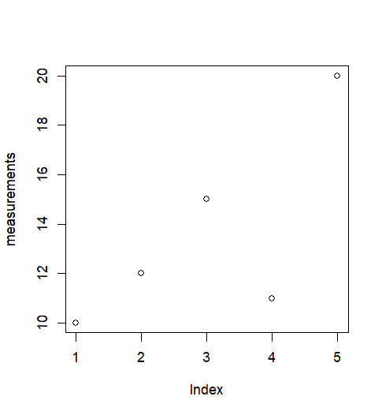

:::::::::::::::::::::::::::::::::::::: questions

- What are R and RStudio, and how do they work together?
- Why use R for research and data analysis?

::::::::::::::::::::::::::::::::::::::::::::::::

::::::::::::::::::::::::::::::::::::: objectives

- Distinguish between R and RStudio.
- Run simple R commands and scripts.
- Give overview of workshop contents.

::::::::::::::::::::::::::::::::::::::::::::::::

## Introduction

R is a programming language for data analysis, statistics, and visualisation.
It allows you to automate analyses, create figures, and document your work so that others can reproduce your results.

RStudio is an integrated development environment (IDE) that makes working with R easier.
It provides a code editor, console, file browser, and tools for viewing plots and managing projects.

Before continuing, make sure you have installed R and RStudio by following the [Setup instructions](../learners/setup.md).

## Exploring RStudio

When you open RStudio, you will typically see:

- **Console:** Run R commands interactively.
- **Source editor:** Write and save reusable scripts.
- **Environment:** View objects created during your session.
- **Files, Plots, and Help:** Navigate files, inspect figures, and access documentation.

You can use the Console to try commands quickly, but saving your work in scripts makes it easier to reproduce and share.

## Using the R Console

Try running the following in the Console:

``` R
2 + 2
```

R can also store values in objects:

``` R
measurements <- c(10, 12, 15, 11, 20)
mean(measurements)
```

You can visualise these values:

``` R
plot(measurements)
```

``` output
{alt="Measurements of 10, 12, 15, 11, and 20 plotted against their index." width='50%'}
```


## R scripts

The Console is useful for exploring data and trying out commands, but commands entered there are not automatically saved for future use.

An **R script** is a plain-text file, usually with the `.R` extension, that contains R code. 
Scripts allow you to organise your analysis into a sequence of steps that can be saved, rerun, and shared with others.

For example, we can combine our previous commands into a script:

``` R
# Create some example data
measurements <- c(10, 12, 15, 11, 20)

# Calculate the mean
print(mean(measurements))

# Visualise the measurements
plot(measurements)
```

In RStudio, you can create a script using **File → New File → R Script** and save it as `analysis.R`.

You can run individual lines using **Ctrl+Enter** (Windows/Linux) or **Cmd+Enter** (macOS), or run the entire script using the **Source** button in the script editor.

Scripts are an important step towards reproducibility: instead of manually repeating commands, you can rerun the same analysis whenever your data changes. However, a script alone does not guarantee reproducibility. 

It may still depend on external files, installed packages, or settings specific to your computer.

## What will you learn in this workshop?

Throughout this workshop, we will improve this project step by step:

- **Reproducibility:** Understand why the analysis fails and what makes research reproducible.
- **Environments:** Recreate the dependencies using `renv` so the code runs.
- **Code quality:** Identify "code smells" and opportunities for improvement.
- **Testing:** Check that changes do not break existing functionality.
- **Refactoring:** Make the code easier to read and maintain.
- **Documentation:** Help others understand and reuse the project.
- **Packaging:** Turn the workflow into a reusable R package.

This workshop will introduce good practices to help make your R code more reproducible, maintainable, and easier to share. 
The principles you learn can also be applied to projects beyond R.

::::::::::::::::::::::::::::::::::::: keypoints

- R is a programming language and RStudio is an environment for working with R.
- Scripts make analyses easier to repeat, share, and maintain.
- Reproducibility also depends on managing packages and computing environments.

::::::::::::::::::::::::::::::::::::::::::::::::
