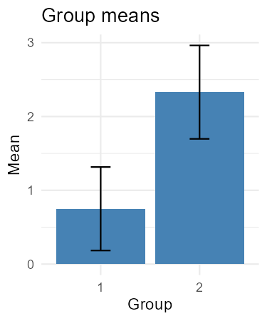
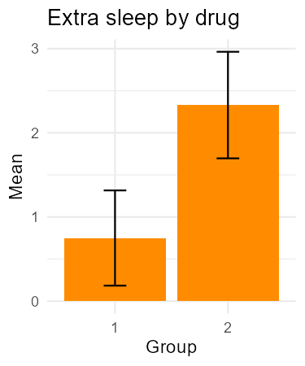

:::::::::::::::::::::::::::::::::::::: questions
- Why write an R package? 
- How do I create a package?
- Where can I publish my packages and what is required?
- How do package version numbers signal change?
::::::::::::::::::::::::::::::::::::::::::::::::

::::::::::::::::::::::::::::::::::::: objectives
- Create a minimal package structure from scratch using `RStudio` or `usethis::create_package()`.
- Add reusable functions with optional arguments in `.R` files inside the `R/` directory.
- Declare package dependencies and load package functions during development.
- Document functions with `roxygen2` and generate their help pages.
- Recognise optional folders and files you might encounter in an R source package.
- Understand how version numbers communicate package lifecycle stages.

::::::::::::::::::::::::::::::::::::::::::::::::
## R packages

We've used several R packages throughout the previous episodes, including `renv`, `ggplot2`, `dplyr`, and `remotes`.
Each of these packages provides functionality beyond what's available in base R.

For example, to create plots using `ggplot2`, you can install and load the package:

``` R
install.packages("ggplot2")
library(ggplot2)
```

You now have access to functions for creating plots, such as `ggplot()` and `geom_point()`.

When you install a package using `install.packages()`, R typically downloads it from [CRAN (the Comprehensive R Archive Network)](https://cran.r-project.org/), the default package repository in most R setups.

CRAN hosts thousands of packages that have been checked against a set of requirements before being made available for others to install.

When you install a package from CRAN, R will also install any required dependencies that aren't already available on your computer.

Once a package is installed, you can load it into your current R session using `library()`.

You only need to install a package once for a given R library, but you need to load it again in each new R session where you want to use it.

### What is an R package?

An R package is a collection of code, documentation, and sometimes data, organised in a standard way that R understands.
This structure makes packages easy to install, load, reuse, and share.

An excellent resource for learning about R package development is [*R Packages*, 2nd edition](https://r-pkgs.org/), a freely available online book by Hadley Wickham and Jennifer Bryan.
It covers everything from organising functions and managing dependencies to writing documentation, testing code, and preparing packages for publication.

::::::::::::::::::::::::::::::::::::: challenge

### Why create an R package?

Visit the [Introduction](https://r-pkgs.org/introduction.html) chapter of *R Packages*, 2nd edition, and read the **Introduction** and **Philosophy** sections.

As you read, consider the following questions:

- Why might creating an R package be useful, even if you never share it with others?
- How do the standard conventions of R packages save time and make package development easier?

::::::::::::::: solution

## Show me the solution

**Packages aren't just for sharing code:** Creating an R package allows us to bring related functions together in one place, rather than keeping them scattered across different scripts and projects.
This makes our code easier to find, update, and reuse without repeatedly copying and pasting functions.
Even if we never share our package with anyone else, organising our code in this way can save time and make our work easier to maintain.
If we do decide to share it, others can install and use our functions just like any other R package.

**Following conventions saves time and effort:** R packages follow a standard structure, with R code stored in `R/`, tests in `tests/`, and data in `data/`.
These conventions mean we don't need to decide how to organise every new project from scratch.
They also allow us to use tools designed specifically for package development.
For example, `usethis` helps create and configure package files, while `devtools` provides functions for loading, testing, and checking packages.
By automating these tasks, we can spend less time worrying about the details of package development and more time focusing on what our package should do.

:::::::::::::::

:::::::::::::::::::::::::::::::::::::

### What does an R package look like?

We've seen why creating an R package can be useful.
But what does a package actually look like behind the scenes?

Let's explore the structure of two packages we've already encountered.

::::::::::::::::::::::::::::::::::::: challenge

### What do R packages have in common?

Explore the GitHub repositories of two packages that came up in previous episodes:

- [ggplot2](https://github.com/tidyverse/ggplot2): for creating plots.
- [dplyr](https://github.com/tidyverse/dplyr): for manipulating data.

Take a few minutes to explore the files and folders in both repositories.
You don't need to understand the code itself; we're interested in how the packages are organised.

- What files and folders do both packages have in common?
- Where are the R functions, tests, and documentation stored?
- What differences can you spot between the two repositories?
- Why do you think packages might need different files or folders?

::::::::::::::: solution

## Show me the solution

**Files and folders in common**

Both packages share several files and folders, including `R/`, `DESCRIPTION`, `NAMESPACE`, `man/`, `tests/`, and `README.md`.

**Where are the different components stored?**

- `R/` contains the R functions.
- `tests/testthat/` contains automated tests.
- `man/` contains documentation for functions.
- `README.md` provides an overview of the package, including what it does, how to install it, and examples of how to use it.
  It serves as an introduction to the package and a starting point for its documentation.

**Differences between packages**

Although both packages follow a common structure, they also have differences.

For example, `ggplot2` includes an `icons/` folder, which you won't find in `dplyr`.

Packages share a standard structure, but they can also include additional files and folders depending on their purpose and development needs.

For example, `ggplot2` is a data visualisation package, so its `icons/` folder contains graphical assets that help illustrate its features.
These are useful for `ggplot2` but are not part of the standard R package structure.

:::::::::::::::

:::::::::::::::::::::::::::::::::::::

Despite serving different purposes, `ggplot2` and `dplyr` follow a recognisable structure.
This is what allows R to install and load packages in a consistent way.

## Creating an R package using RStudio

Now that we've explored how existing R packages are organised, let's create one of our own.

Fortunately, we don't need to create all the files and folders ourselves.

RStudio can generate the basic package structure automatically.

### Creating a folder for our packages

Before creating our first package, let's create a folder to keep our R packages together.

We'll call this folder `rpackages` and use it to store the two packages we'll create in this lesson.

1. Open the **Files** pane in RStudio.
2. Navigate to your home directory, which is your personal folder on your computer (for example, `C:\Users\YourName` on Windows or `/home/yourname` on Linux).
3. Click **New Folder**.
4. Enter `rpackages` as the folder name and click **OK**.

You should now have a folder called `rpackages` in your home directory.

We'll create our first package, `rstudiopackage`, inside this folder using the RStudio menus.

Later, we'll create a second package, `sleep`, using `usethis` and develop it using code from our earlier sleep analysis.

This will allow us to compare the two approaches without overwriting either package.

### Creating a package using the RStudio menus

To create a package using RStudio:

1. Go to **File > New Project...**.
2. Select **New Directory**.
3. Select **R Package**.
4. Enter `rstudiopackage` as the package name.
5. Under **Create project as subdirectory of**, click **Browse** and select the `rpackages` folder you just created.
6. You'll also see some optional settings:
   - **Create a git repository:** Initialises a local Git repository so you can track changes to your package using version control.
     This doesn't automatically create a repository on GitHub.
   - **Use renv with this project:** Sets up `renv` to manage package versions used during development, helping make your development environment reproducible.
     You might recognise `renv` from the reproducibility episode.
7. For this exercise, leave both options unchecked.
8. Click **Create Project**.

RStudio will create a directory called `rstudiopackage` inside `rpackages` and open it as a new project.

::::::::::::::::::::::::::::::::::::: challenge

### Explore your new package

RStudio has created a new project for your package.

You might also notice that an example R script has opened automatically, containing a function called `hello()`.

Take a few minutes to explore what RStudio has created.

- Look at the **Files** pane in RStudio.
  What files and folders have been created?
- Open the `R/` folder and find the example `hello.R` script.
  What does the `hello()` function do?
- Open the `DESCRIPTION` file.
  What information does it contain?
  Can you identify any placeholder values?

::::::::::::::: solution

## Show me the solution

**Package structure**

Your package should contain a structure similar to this:

```text
rpackages/
└── rstudiopackage/
    ├── .Rbuildignore
    ├── .gitignore
    ├── DESCRIPTION
    ├── NAMESPACE
    ├── R/
    │   └── hello.R
    └── rstudiopackage.Rproj
```

The exact files may vary depending on your RStudio version and the options you selected when creating the project.

Some hidden files, such as `.gitignore`, might not be visible in the Files pane.

**The `hello.R` script**

Inside `R/`, you'll find an example function:

``` R
# Hello, world!
#
# This is an example function named 'hello' 
# which prints 'Hello, world!'.
#
# You can learn more about package authoring with RStudio at:
#
#   https://r-pkgs.org
#
# Some useful keyboard shortcuts for package authoring:
#
#   Install Package:           'Ctrl + Shift + B'
#   Check Package:             'Ctrl + Shift + E'
#   Test Package:              'Ctrl + Shift + T'

hello <- function() {
  print("Hello, world!")
}
```

The `hello()` function simply prints `"Hello, world!"` when called.

RStudio includes it as an example of how functions are organised inside an R package.

**The `DESCRIPTION` file**

The `DESCRIPTION` file contains information about your package, including its name, version, authors, description, and licence.

RStudio generates this file from a template, so some fields contain example values or placeholders.

Your file will look something like this:

```text
Package: rstudiopackage
Type: Package
Title: What the Package Does (Title Case)
Version: 0.1.0
Authors@R: c(
    person(
      "Jane", "Doe",
      email = "jane@example.com",
      role = c("aut", "cre")
    )
  )
Description: More about what it does (maybe more than one line).
    Continuation lines should be indented.
License: What license is it under?
Encoding: UTF-8
LazyData: true
```

For example, `Title` and `Description` contain instructions rather than meaningful descriptions of your package.

The author information also contains example details that need to be replaced.

These placeholders help us understand what information is expected, but we'll need to update them as we develop the package.

:::::::::::::::

:::::::::::::::::::::::::::::::::::::

## Creating an R package using `usethis`

RStudio uses [`usethis`](https://usethis.r-lib.org/) behind the scenes when creating a new R package.

RStudio provides a convenient graphical interface for creating packages, but `usethis` can also be used directly from the R console to perform package development tasks.

Using `usethis` directly gives us access to a wider range of functions than those available through the RStudio interface.
These functions help automate many additional package development tasks.

For example, it can:

- **Set up testing infrastructure** with `use_testthat()`, creating the necessary files and folders and updating `DESCRIPTION`.
- **Add package dependencies** with `use_package()`, updating `DESCRIPTION` automatically.
- **Create a README** with `use_readme_md()`, providing a starting point for documenting the package.
- **Set up longer tutorials** with `use_vignette()`, creating a vignette template and updating the necessary configuration.
- **Configure automated checks on GitHub** with `use_github_action()`, creating a GitHub Actions workflow.

These tasks can be completed manually, but `usethis` reduces the amount of setup required and helps ensure that the necessary files and configuration are in place.

Let's create a second package using `usethis` and compare it with the one we created using RStudio.

We'll call this package `sleep` and save it inside the same `rpackages` folder.
We'll develop it using code from our earlier sleep analysis.

### Creating a package with `usethis::create_package()`

First, install `usethis` if you haven't already:

``` R
install.packages("usethis")
```

Before creating the package, we need to make sure that our working directory is set to the `rpackages` folder we created earlier.

You can check your current working directory using:

``` R
getwd()
```

If necessary, change your working directory using the RStudio menu:

1. Go to **Session > Set Working Directory > Choose Directory...**.
2. Navigate to the `rpackages` folder.
3. Click **Open** or **Choose**, depending on your operating system.

Check that your working directory is now `rpackages`:

``` R
getwd()
```

For example, on Windows you might see:

```text
[1] "C:/Users/YourName/rpackages"
```

Your full path will differ, but it should end in `rpackages`.

Once you're in the correct directory, run:

``` R
usethis::create_package("sleep")
```

This creates a new directory called `sleep` inside `rpackages`, containing the basic structure of an R package.

Depending on your RStudio settings, the new package may also open automatically as an RStudio project.

We should now have two packages stored inside `rpackages`:

```text
rpackages/
├── rstudiopackage/
└── sleep/
```

::::::::::::::::::::::::::::::::::::: challenge

### Compare the two packages

We now have two packages: `rstudiopackage`, created using RStudio, and `sleep`, created using `usethis`.

Take a few minutes to explore their files and folders.

- What files and folders do both packages have in common?
- Open the `R/` directory in each package.
  Does either contain an example function?
- Open the `DESCRIPTION` file in each package.
  What information does it contain?
  Can you identify any placeholder values?
- What differences can you spot between the two packages?

::::::::::::::: solution

## Show me the solution

**Package structure**

After running `usethis::create_package()`, your second package should contain a structure similar to this:

```text
rpackages/
├── rstudiopackage/
│   ├── .Rbuildignore
│   ├── .gitignore
│   ├── DESCRIPTION
│   ├── NAMESPACE
│   ├── R/
│   │   └── hello.R
│   └── rstudiopackage.Rproj
└── sleep/
    ├── .Rbuildignore
    ├── .gitignore
    ├── .Rhistory
    ├── DESCRIPTION
    ├── NAMESPACE
    ├── R/
    └── sleep.Rproj
```

The exact files and folders may vary depending on the versions of RStudio and `usethis` you're using.

Both RStudio and `usethis` create the basic structure of an R package, including `DESCRIPTION`, `NAMESPACE`, and `R/`.

One difference is that RStudio typically creates an example `hello.R` script inside `R/`, whereas `usethis::create_package()` does not create an example function by default.

The `R/` directory in `sleep` will therefore initially be empty, ready for us to add our own functions.

Some files beginning with a dot (`.`), such as `.gitignore`, might not be visible in the Files pane.

**The `DESCRIPTION` file**

Both methods create a `DESCRIPTION` file containing information about the package, including its name, version, authors, description, and licence.

The `DESCRIPTION` file created by `usethis`, should look similar to this:

```text
Package: sleep
Title: What the Package Does (One Line, Title Case)
Version: 0.0.0.9000
Authors@R:
    person("First", "Last", , "first.last@example.com", role = c("aut", "cre"))
Description: What the package does (one paragraph).
License: `use_mit_license()`, `use_gpl3_license()` or friends to pick a
    license
Encoding: UTF-8
Roxygen: list(markdown = TRUE)
```

You may notice some differences compared with the template created using the RStudio menus.

For example, the initial version number is typically `0.0.0.9000` rather than `0.1.0`.

Both templates also contain placeholder information that we'll need to update as we develop our packages.

:::::::::::::::

:::::::::::::::::::::::::::::::::::::

## The structure of an R package

We've now created two R packages and explored their structure.

Let's take a closer look at three core components.

### Core components 

| Component | Purpose |
|---|---|
| `DESCRIPTION` | Contains information about the package, such as its name, version, authors, licence, and dependencies. |
| `R/` | Contains the R scripts defining the package's functions. |
| `NAMESPACE` | Contains instructions about which functions the package makes available and how it uses functions from other packages. |

**The `DESCRIPTION` file**

Every R package needs a `DESCRIPTION` file.
We've already seen that RStudio and `usethis` create it automatically with placeholder information that we can update.

**The `R/` directory**

Every R package containing R code has an `R/` directory.
This directory contains the `.R` scripts that define the package's functions.

We can organise related functions in one or several scripts, and filenames don't need to match function names.

**The `NAMESPACE` file**

Each R package has its own **namespace**, which keeps its functions and other objects separate from those in other packages.
This helps R distinguish between functions with the same name.

The `NAMESPACE` file contains instructions that control which functions a package makes available to users and which functions it imports from other packages.

We'll explore this in more detail below.

#### More about namespaces

Two important types of namespace instructions are:

- **Exports:** Functions that a package makes available to users.
- **Imports:** Functions that a package brings in from other packages for use in its own code.

We can use `::` to call an **exported function** from a specific package without first loading it with `library()`.

For example, we used this when installing `obscurepackage` from GitHub:

``` R
remotes::install_github("stellaprins/obscurepackage")
```

Here, `remotes` is the **package name**, and `install_github()` is the **function name**.
This works because `remotes` exports `install_github()`.

When writing our own package, we can also use functions from other packages.
For example, we can call `dplyr::summarise()` inside our functions without importing it into our namespace.
Alternatively, we could import `summarise()` and call it without the `dplyr::` prefix.

We usually don't edit `NAMESPACE` manually.
Instead, `roxygen2` generates it from special comments in our R scripts.
Later, we'll use `@export` to make functions from our own package available to users.

::::::::::::::::::::::::::::::::::::: challenge

## Why are namespaces useful?

Read [Section 10.2.1, *Motivation*](https://r-pkgs.org/dependencies-mindset-background.html#sec-dependencies-namespace) in *R Packages*, 2nd edition.

Using the examples in this section, **explain two reasons why namespaces are useful**.

::::::::::::::: solution

## Show me the solution

Namespaces therefore help packages behave consistently, even when users define functions with the same names.

Both examples show how namespaces **prevent naming conflicts**.
The first shows how we can use `::` to choose a function, while the second shows how namespaces ensure that package functions use the correct functions internally.

**1. Choosing the right function when different packages use the same name**

Both `here` and `lubridate` provide a function called `here()`, but these functions do different things.

If we attach both packages using `library()`, calling `here()` uses the version from whichever package was attached last.
This means the same function call could give different results depending on the order in which we attach the packages.

We can use `::` to specify exactly which function we want:

``` R
here::here()
lubridate::here()
```

This works regardless of the order in which the packages were attached.

**2. Ensuring package functions use the correct functions internally**

Package functions often use other functions internally.
Namespaces help them find the correct functions, even when other objects have the same names.

For example, `stats::sd()` uses `var()` to calculate standard deviations.
Suppose we define our own function:

``` R
var <- function(x) -5
```

Calling `var(1:5)` now returns `-5`, but `stats::sd(1:5)` still works correctly.
This is because `sd()` uses `var()` from the `stats` namespace rather than our version.


:::::::::::::::

:::::::::::::::::::::::::::::::::::::

For more information, see the [discussion of namespaces in *R Packages*, 2nd edition](https://r-pkgs.org/dependencies-mindset-background.html#sec-dependencies-namespace).

### Other components 

As our package develops, we may add other files and directories.

| Component | Purpose |
|---|---|
| `man/` | Help files for package functions, typically generated automatically by `roxygen2`. |
| `tests/` | Automated tests that check our code works as expected. |
| `README.md` | An introduction to the package and how to use it. |
| `vignettes/` | Longer tutorials showing how to use the package. |
| `data/` | Datasets included with the package. |

Not every package needs all these components.

However, a `README.md` file and automated tests are highly recommended, even for small packages, to help others understand the package and ensure it works as expected.

For more information, see the [Package structure](https://r-pkgs.org/structure.html) chapter of *R Packages*, 2nd edition.

## Adding functions to our package

In our earlier sleep analysis, we used the built-in `sleep` dataset to calculate summary statistics for each drug group and plot the results.
Let's organise those steps into three functions in our `sleep` package:

- `load_sleep_data()`: returns the built-in sleep dataset.
- `summarise_data()`: calculates summary statistics for a chosen measurement and grouping column.
- `plot_summary()`: plots group means and standard errors, with options for the bar colour and title.

Open the `sleep` package project in RStudio by opening `sleep.Rproj` inside `rpackages/sleep/`.

We'll keep each function in its own script and add documentation above it using [`roxygen2`](https://roxygen2.r-lib.org/articles/rd.html) comments, which begin with `#'`.
These comments describe what a function does, its inputs (`@param`), its output (`@returns`), and examples of how to use it (`@examples`).

### `load_sleep_data()`

Run this command in the R console to create and open `R/load_sleep_data.R`:

``` R
usethis::use_r("load_sleep_data")
```

Download [load_sleep_data.R](files\02-environments\07-packaging\load_sleep_data.R) and save it in the `R` folder.


``` R
#' Load the built-in sleep data
#'
#' Get the data used in our sleep analysis.
#'
#' @returns A data frame with columns extra (extra sleep in hours),
#'   group (drug group), and ID (participant).
#' @seealso [Official sleep dataset documentation](https://stat.ethz.ch/R-manual/R-devel/library/datasets/html/sleep.html)
load_sleep_data <- function() {
  datasets::sleep
}
```

We use `datasets::sleep` to refer to the built-in dataset and distinguish it from our package named `sleep`.
This function has no inputs, so it doesn't need an `@param` tag.

### `summarise_data()`

Create and open `R/summarise_data.R`:

``` R
usethis::use_r("summarise_data")
```

Download [summarise_data.R](files\02-environments\07-packaging\summarise_data.R) and save it in the `R` folder.

``` R
#' Summarise a numeric measurement by group
#'
#' Calculate the mean, standard deviation, sample size, and standard error
#' for each group.
#'
#' @param data A data frame.
#' @param value_col Name of the numeric column.
#' @param group_col Name of the grouping column.
#' @returns A data frame with group, mean, sd, n, and se.
summarise_data <- function(data, value_col = "extra", group_col = "group") {

  selected_data <- data.frame(
    group = data[[group_col]],
    value = data[[value_col]]
  )

  selected_data |>
    dplyr::summarise(
      mean = mean(value),
      sd = stats::sd(value),
      n = dplyr::n(),
      se = sd / sqrt(n),
      .by = "group"
    )
}

```

This function packages up the summary calculation from our earlier analysis, using the data we pass to it.
The column-name arguments let us choose what to summarise and how to group it.
For example, `data[[value_col]]` selects the column named by `value_col`.
The defaults match the sleep dataset; `.by = "group"` calculates separate statistics for each group.
The output always uses the same column names, so it can be passed directly to `plot_summary()`.

### `plot_summary()`

Create and open `R/plot_summary.R`:

``` R
usethis::use_r("plot_summary")
```

Download [plot_summary.R](files\02-environments\07-packaging\plot_summary.R) and save it in the `R` folder.

``` R
#' Plot group means and standard errors
#'
#' Show means with error bars extending one standard error above and below.
#'
#' @param summary_data A data frame containing group, mean, and se.
#' @param fill Bar colour.
#' @param title Plot title.
#' @returns A ggplot object.
plot_summary <- function(summary_data, fill = "steelblue",
                         title = "Group means") {

  ggplot2::ggplot(
    summary_data,
    ggplot2::aes(x = factor(group), y = mean)
  ) +
    ggplot2::geom_col(fill = fill) +
    ggplot2::geom_errorbar(
      ggplot2::aes(ymin = mean - se, ymax = mean + se),
      width = 0.2
    ) +
    ggplot2::labs(title = title, x = "Group", y = "Mean") +
    ggplot2::theme_minimal()
}
```

The function expects columns named `group`, `mean`, and `se`, matching the output of `summarise_data()`.
Other summary tables can also be used if they contain these columns.

Save all three scripts, then open the `R/` folder in RStudio's **Files** pane.
You should see `load_sleep_data.R`, `summarise_data.R`, and `plot_summary.R` inside your package.
`usethis::use_r()` is a convenient way to create and open them, but you can also create `.R` scripts manually and save them in this folder.

## Testing functions  using `devtools`

We can use `devtools::load_all()` to load our package functions during development without installing the package.
If you haven't already installed `devtools`, run `install.packages("devtools")` in the R console first.

First, load the package functions:

``` R
devtools::load_all()
```

Load the sleep dataset:

``` R
data <- load_sleep_data()
```

Calculate the summary statistics:

``` R
summary_data <- summarise_data(data)
```

Print the summary table:

``` R
print(summary_data)
```

You should see this table in the Console (the number of decimal places displayed may vary):

```text
  group mean       sd  n        se
1     1 0.75 1.789010 10 0.5657345
2     2 2.33 2.002249 10 0.6331666
```

There is one row per drug group, with 10 observations in each group.
Now plot the summaries:

``` R
plot_summary(summary_data)
```

The following plot should appear in RStudio's **Plots** pane:



We can change the bar colour and title using the optional arguments:

```r
plot_summary(summary_data, fill = "darkorange", title = "Extra sleep by drug")
```

The **Plots** pane should now show the same values with orange bars and the title "Extra sleep by drug":

 

## Generating help pages

Earlier, we used commands such as `?renv` to access help in R.
Before generating our package's documentation, try opening the help for one of our functions:

``` R
?summarise_data
```

R cannot find a help page for this function yet.
You may see a message like this:

```text
No documentation for ‘summarise_data’ in specified packages and libraries:
you could try ‘??summarise_data’
```

The suggestion `??summarise_data` searches help topic names, titles, and concepts across installed packages (see [`help.search()`](https://stat.ethz.ch/R-manual/R-devel/library/utils/html/help.search.html)).
It searches existing documentation, not our script comments, so it won't find help for our function yet.

Save all three scripts, then run `devtools::document()` to generate these files in `man/`.

``` R
devtools::document()
```

The first time you generate the help files, you should see messages similar to these:

```text
ℹ Updating sleep documentation
ℹ Loading sleep
Writing load_sleep_data.Rd
Writing plot_summary.Rd
Writing summarise_data.Rd
```

Each `Writing` message names a help file saved in your package's `man/` folder.

Reload the package so we can view the help pages during development:

``` R
devtools::load_all()
```

You should see a message confirming that the package is loading:

```text
ℹ Loading sleep
```

Now open the help page for `load_sleep_data()`:

``` R
?load_sleep_data
```

You should see this message in the Console:

```text
ℹ Rendering development documentation for "load_sleep_data"
```

The documentation opens in RStudio's **Help** pane, showing what the function does, what it returns, and an example of how to use it.
You can open the other functions' help pages in the same way using `?summarise_data` and `?plot_summary`.

When you change the documentation comments, save the script and run `devtools::document()` again to update the help files.

## Declaring dependencies

Declare the packages used by our functions in `DESCRIPTION`:

``` R
usethis::use_package("datasets")
usethis::use_package("dplyr", min_version = "1.1.0")
usethis::use_package("ggplot2", min_version = "3.0.0")
usethis::use_package("R", type = "Depends", min_version = "4.1.0")
```

These commands record package dependencies in `Imports` and the R requirement in `Depends` in `DESCRIPTION`.
The minimum versions ensure the features we use are available; `>=` means "this version or newer".

Open `DESCRIPTION` in the **Files** pane.
It should now include:

```text
Depends:
    R (>= 4.1.0)
Imports:
    datasets,
    dplyr (>= 1.1.0),
    ggplot2 (>= 3.0.0)
```

## Making our functions available

So far, we've used `devtools::load_all()` to try our functions during development.
However, we also want people who install our package to be able to use them.

Earlier, we learned that a package's `NAMESPACE` controls which functions are available to users.
We can **export** our three functions by adding `#' @export` to their `roxygen2` documentation.

For example, update `R/load_sleep_data.R` to include:

``` R
#' Load the built-in sleep data
#'
#' Get the data used in our sleep analysis.
#'
#' @returns A data frame with columns extra (extra sleep in hours),
#'   group (drug group), and ID (participant).
#' @seealso [Official sleep dataset documentation](https://stat.ethz.ch/R-manual/R-devel/library/datasets/html/sleep.html)
#' @export
load_sleep_data <- function() {
  datasets::sleep
}
```

Add `#' @export` to the documentation for `summarise_data()` and `plot_summary()` too.

Then regenerate the documentation:

``` R
devtools::document()
```

Open the `NAMESPACE` file in RStudio.
It should now contain:

```text
export(load_sleep_data)
export(plot_summary)
export(summarise_data)
```

These instructions tell R which functions people can use after installing and loading our package.
As we saw earlier, `roxygen2` generates `NAMESPACE` automatically, so we don't need to edit it ourselves.


## Adding the analysis script

Installing our package gives others access to its functions, but doesn't show how we used them to produce our results.
For that, we also need an **analysis script**.

In the `sleep` project, create a folder called `scripts/`.

Download [sleep_analysis.R](files\02-environments\07-packaging\sleep_analysis.R) and save it in the `scripts` folder.

``` R
# Sleep analysis
#
# Load the built-in sleep dataset, calculate and plot summary statistics
#
# Uses functions from the sleep package.

library(sleep)

data <- load_sleep_data()
summary_data <- summarise_data(data)

print(summary_data)

plot_summary(
  summary_data,
  fill = "mediumpurple",
  title = "Extra Sleep by Drug"
)
```

Our project now has two places for R code:

- **`R/`** contains reusable package functions.
- **`scripts/`** contains scripts that use those functions to perform an analysis.

We should commit our analysis scripts to Git alongside the package code.
When we push these changes to GitHub, colleagues can access the scripts and see how our results were produced.

These scripts aren't needed to install and use the package, so we can exclude them from the files distributed with the package:

```r
usethis::use_build_ignore("scripts")
```

**Running the analysis script**

Now that we've exported our functions, we can install the package locally from the `sleep` project:

```r
devtools::install()
```

Then run the analysis script:

```r
source("scripts/sleep_analysis.R")
```

The script uses `library(sleep)` to load our installed package. It should print the summary statistics and display the plot in RStudio's **Plots** pane.

Although `scripts/` is excluded from the installed package, it remains in our project and can be shared through GitHub.


## Checking our package

We've now added functions to our `sleep` package, generated their help pages, declared dependencies, and made the functions available to users.

We also need to check that the package follows R's package development requirements.

We can do this using `devtools::check()`, which checks our package's code, documentation, dependencies, and structure.

Run the following command in the R console:

```r
devtools::check()
```

This runs a series of checks and reports three types of messages:

- **Errors:** Problems that must be fixed.
- **Warnings:** Potential problems that should be investigated.
- **Notes:** Issues worth reviewing, even if the package works correctly.

::::::::::::::::::::::::::::::::::::: challenge

### Check your package

Look at the output from `devtools::check()`.

**Your tasks:**

1. How many errors, warnings, and notes are reported?
2. Look at the NOTES in the output. Which functions and variables are mentioned? Why might R be reporting them?

::::::::::::::: solution

## Show me the solution

The exact results may vary depending on your package and development environment.

You might see NOTES such as:

```text
plot_summary: no visible binding for global variable 'group'
plot_summary: no visible binding for global variable 'se'
summarise_data: no visible binding for global variable 'value'
summarise_data: no visible binding for global variable 'sd'
summarise_data: no visible binding for global variable 'n'
Undefined global functions or variables:
  group n sd se value
Consider adding
  importFrom("stats", "sd")
to your NAMESPACE file.
```

These NOTES refer to column names used in our `summarise_data()` and `plot_summary()` functions.

They occur because `dplyr` and `ggplot2` recognise column names such as group, value, and se, but R's package checker does not always recognise them.

The suggestion to import `sd()` relates to **namespaces**, which we explored earlier. However, our function already uses `stats::sd()` to specify which package provides the function, so we don't need to import it separately.

These NOTES do not necessarily mean our functions are incorrect.

:::::::::::::::

:::::::::::::::::::::::::::::::::

It's good practice to run `devtools::check()` regularly as we develop our package, particularly after making changes to its functions, documentation, or dependencies.

Ideally, we should aim to resolve all errors, warnings, and notes before publishing a package, especially when submitting it to CRAN.

For more information, see:

- [*R Packages*, 2nd edition – Checking](https://r-pkgs.org/check.html), which explains package checks and how to interpret their results.
- [Using dplyr in packages](https://dplyr.tidyverse.org/articles/in-packages.html), which explains why NOTES about column names occur and how to address them.


::::::::::::::::::::::::::::::::::::: challenge

### Resolving package check NOTES (extra)

In the previous challenge, we saw that `devtools::check()` reported several undefined variables in our `summarise_data()` and `plot_summary()` functions.

These NOTES occur because `dplyr` and `ggplot2` allow us to refer directly to data-frame columns by name, but R's package checker cannot always recognise these references.

We can resolve them using `.data$column`, which explicitly identifies a column in the data being processed.

**Your tasks:**

1. Update `summarise_data()` and `plot_summary()` to use `.data$column` when referring to data-frame columns.
2. Add `rlang` as a package dependency and import `.data` into the package namespace.
3. Regenerate the documentation and run `devtools::check()` again.
4. How many errors, warnings, and notes are now reported?

::::::::::::::: solution

## Show me the solution

**1. Update `summarise_data()`**

Open `R/summarise_data.R` and replace its contents with:

```r
#' Summarise a numeric measurement by group
#'
#' Calculate the mean, standard deviation, sample size, and standard error
#' for each group.
#'
#' @param data A data frame.
#' @param value_col Name of the numeric column.
#' @param group_col Name of the grouping column.
#' @returns A data frame with group, mean, sd, n, and se.
#' @importFrom rlang .data
#' @export
summarise_data <- function(data, value_col = "extra", group_col = "group") {

  selected_data <- data.frame(
    group = data[[group_col]],
    value = data[[value_col]]
  )

  selected_data |>
    dplyr::summarise(
      mean = mean(.data$value),
      sd = stats::sd(.data$value),
      n = dplyr::n(),
      se = .data$sd / sqrt(.data$n),
      .by = "group"
    )
}
```

Previously, we wrote `mean(value)`. Although `dplyr` understands that `value` refers to a column, R's package checker may treat it as an undefined variable.

Writing `mean(.data$value)` makes this explicit: we're using the `value` column of the data being processed.

Similarly, `.data$sd` and `.data$n` refer to columns created earlier in the same `summarise()` call.

**2. Update `plot_summary()`**

Open `R/plot_summary.R` and replace its contents with:

```r
#' Plot group means and standard errors
#'
#' Show means with error bars extending one standard error above and below.
#'
#' @param summary_data A data frame containing group, mean, and se.
#' @param fill Bar colour.
#' @param title Plot title.
#' @returns A ggplot object.
#' @export
plot_summary <- function(summary_data, fill = "steelblue",
                         title = "Group means") {

  ggplot2::ggplot(
    summary_data,
    ggplot2::aes(x = factor(.data$group), y = .data$mean)
  ) +
    ggplot2::geom_col(fill = fill) +
    ggplot2::geom_errorbar(
      ggplot2::aes(
        ymin = .data$mean - .data$se,
        ymax = .data$mean + .data$se
      ),
      width = 0.2
    ) +
    ggplot2::labs(title = title, x = "Group", y = "Mean") +
    ggplot2::theme_minimal()
}
```

Here, `.data$group`, `.data$mean`, and `.data$se` explicitly refer to columns in `summary_data`.

**3. Declare the dependency**

The `.data` pronoun is provided by the `rlang` package.

We've already added `#' @importFrom rlang .data` above `summarise_data()`. This tells `roxygen2` to import `.data` into our package namespace.

However, as we learned earlier, importing an object from another package also requires us to declare that package as a dependency.

Run:

```r
usethis::use_package("rlang", min_version = "1.0.0")
```

This adds `rlang` to the `Imports` field in `DESCRIPTION`, with a minimum required version:

```text
rlang (>= 1.0.0)
```

Remember that `DESCRIPTION` declares which packages our package needs, while `NAMESPACE` specifies which objects we import from them.

**4. Regenerate the documentation and check the package**

Save your changes and run:

```r
devtools::document()
devtools::check()
```

Open `NAMESPACE`. Alongside the existing exports, it should now contain:

```text
importFrom(rlang,.data)
```

If there are no other issues, the check should report:

```text
0 errors ✔ | 0 warnings ✔ | 0 notes ✔
```

**Why does this work?**

Using `.data$column` makes it explicit that we're referring to a data-frame column rather than a separate variable.

This also connects to what we learned earlier about namespaces:

- `stats::sd()` identifies the `sd()` function from the `stats` package.
- `.data$sd` identifies a column called `sd` in the data being processed.

The original check output suggested importing `sd()` from `stats`. 
However, our function already uses `stats::sd()`, so this additional import is unnecessary. 
The NOTE appeared because `sd` was also being used as a column name.

Finally, `DESCRIPTION` and `NAMESPACE` work together: `DESCRIPTION` declares that our package depends on `rlang`, while `NAMESPACE` records that we import `.data` from it.

By making our column references explicit and declaring the dependency correctly, we resolve the NOTES without changing what our functions do.

:::::::::::::::

:::::::::::::::::::::::::::::::::

## Preparing our package for sharing

Before sharing our package, we should make sure it explains what it does, who created it, and how others can use it.

**Updating `DESCRIPTION`**

We've already used `DESCRIPTION` to declare our dependencies.
Now let's replace its placeholder information with a meaningful title, description, and author details.

For example, the main fields could look like this:

```text
Package: sleep
Title: Summarise and Visualise Grouped Measurements
Version: 0.0.0.9000
Authors@R:
    person("First", "Last", , "first.last@example.com", role = c("aut", "cre"))
Description: Summarise numeric measurements by group using means,
    standard deviations, sample sizes, and standard errors.
    Visualise group means with standard-error bars.
    Includes a helper for loading the built-in sleep dataset.
```

Replace the example author details with your own.
Keep the dependency and other configuration fields already present in your `DESCRIPTION` file.

We should also choose a licence so others know how they are allowed to use and share our code.
For example, to use the MIT licence, run:

``` R
usethis::use_mit_license()
```

This creates the licence files and updates `DESCRIPTION`.

**Adding a README**

A README introduces a package and helps others get started.

Create one for our package:

``` R
usethis::use_readme_md()
```

This creates a template that we can replace with a short introduction, installation instructions, and an example.

For example:

````markdown
# sleep

An R package for summarising grouped data and plotting means with standard-error bars.

## Installation

**For users:** Install the package from GitHub:

```r
install.packages("remotes")
remotes::install_github("yourusername/sleep")
```

**For developers:** Clone the repository:

```bash
git clone https://github.com/yourusername/sleep.git
```

Open `sleep.Rproj` in RStudio. Then load the package during development:

```r
install.packages("devtools")
devtools::load_all()
```

To install the package locally, use `devtools::install()`.


## License
MIT License.
````

Replace `yourusername` with your GitHub username.
The installation command will work once we've uploaded our package to that repository.


## Publishing our package 

Like `ggplot2` and `dplyr`, we can share our `sleep` package on [GitHub](https://github.com/).
[GitLab](https://gitlab.com/) is a similar alternative for hosting and sharing code.

**If you have a GitHub account**, open the `sleep` project in RStudio and run:

``` R
usethis::use_git()
usethis::use_github()
```

The first command sets up Git to track changes, while the second helps publish our package on GitHub.

Follow the instructions in the R console to configure authentication and commit your changes.

Once published, others can install the package, just as we installed `obscurepackage` earlier:

``` R
remotes::install_github("yourusername/sleep")
```

Replace `yourusername` with your GitHub username.

They can then load the package and use our exported functions:

``` R
library(sleep)

data <- load_sleep_data()
summary_data <- summarise_data(data)
print(summary_data)
plot_summary(summary_data)
```

Alternatively, the repository can be **cloned** to get a local copy of the package's source code, including its functions, documentation, and analysis scripts.

This can be done using [`git`](https://git-scm.com/), by running:

```bash
git clone https://github.com/yourusername/sleep.git
```

This creates a folder called `sleep` containing the project files. 
They can then open `sleep.Rproj` in RStudio to explore the code, reproduce the analysis, or contribute to the package.


### Keeping track of versions

Remember how a newer version of `obscurepackage` changed the results in the environments episode?
Even when we share our code, we need to know **which version** was used.

Our package started with:

```text
Version: 0.0.0.9000
```

This indicates a development version.
For a first release, we might change it to:

```text
Version: 0.1.0
```

A common versioning convention is:

| Change | Example |
|---|---|
| Bug fix (patch) | `0.1.0` -> `0.1.1` |
| New feature (minor) | `0.1.0` -> `0.2.0` |
| Breaking change (major) | `1.0.0` -> `2.0.0` |

We can also use [GitHub Releases](https://docs.github.com/en/repositories/releasing-projects-on-github/about-releases) to mark a particular version of our package with a tag, such as `v0.1.0`.

Once that tag exists, someone can install the tagged version using:

``` R
remotes::install_github("yourusername/sleep@v0.1.0")
```

Changing the version number in `DESCRIPTION` doesn't automatically create a GitHub release or tag.

For reproducibility, record the package version or Git commit used in the analysis, alongside the analysis project's `renv.lock`.

We've now taken our sleep analysis from a collection of scripts to a reusable package that others can install, understand, and develop further.

::::::::::::::::::::::::::::::::::::: keypoints

- R packages organise reusable code, documentation, and data in a standard structure.
- `RStudio` and `usethis` can create package structures automatically.
- Store functions in `R/` and declare dependencies in `DESCRIPTION`.
- Use `devtools::load_all()` to test functions during development.
- Document and export functions using `roxygen2`, and generate help pages with `devtools::document()`.
- Use `devtools::check()` to identify issues before sharing a package.
- Share packages through platforms such as GitHub and use version numbers to track changes.

::::::::::::::::::::::::::::::::::::::::::::::::